# SIEM Implementation & SOC Detection Engineering: Thornbury Wealth Partners

Splunk Enterprise deployed as the centralised SIEM for Thornbury Wealth Partners (TWP), a multi-jurisdictional financial services firm with offices in London, New York and Toronto. Seven SPL detections, scheduled alerts and a unified SOC dashboard.

> Thornbury Wealth Partners is a fictional company and the log data is simulated, created for this training project.

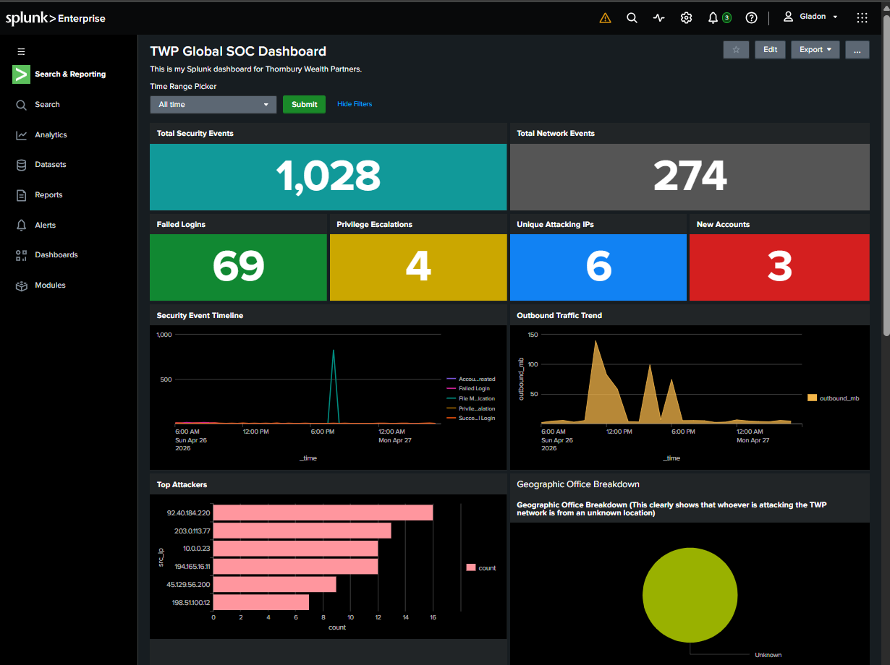

## Business context

TWP provides equity trading and portfolio management, investment banking and M&A advisory, SWIFT-based international wire transfers, and regulatory reporting to the FCA (UK), SEC (US) and OSC (Canada). It runs a hybrid Microsoft Windows Active Directory environment with domain controllers in each office, file servers hosting client portfolios, SQL servers backing the trading platform, and a dedicated SWIFT host in London.

| Office | Subnet |
|---|---|
| London HQ | 192.168.10.0/24 |
| New York | 10.10.0.0/24 |
| Toronto | 10.20.0.0/24 |

As a regulated firm handling client wealth, payment instructions and material non-public information, TWP is a high-value target for APT groups, financially motivated criminals and ransomware operators.

## Objectives

- Deploy Splunk Enterprise as the centralised SIEM
- Onboard Windows Security Event logs and network/firewall logs into dedicated indexes
- Integrate a threat-intelligence lookup table for IP-based enrichment
- Develop seven detection use cases: brute force, account compromise, privilege escalation, data exfiltration, account creation, ransomware behaviour and threat-intel matches
- Convert each detection into a scheduled, throttled alert with severity
- Build a unified SOC dashboard
- Map detections to MITRE ATT&CK

## Tools

Splunk Enterprise · SPL · Splunk lookups · Scheduled alerts · Classic dashboards · MITRE ATT&CK · NIST CSF

## What I did

### Step 1: Splunk setup and user roles
Created the Splunk Enterprise environment and the following roles:

| Role | Splunk access |
|---|---|
| SOC Manager | admin |
| Detection Engineer | power user |
| Tier 1 SOC Analyst | user, restricted index access |
| Tier 2 SOC Analyst | user, broader search |
| Compliance Auditor | read-only |
| Threat Intelligence Analyst | custom, lookup-table edit rights |

### Step 2: Data onboarding
- Created dedicated indexes `security` and `network`.
- Uploaded `security_events.csv` and `network_traffic.csv` through Settings > Add Data > Upload, sourcetype `csv`.
- Uploaded `threat_intel_ips.csv` as a lookup table file and registered the lookup definition `threat_intel_ips` (file-based).

| Indexes | Lookup definition |
|---|---|
| 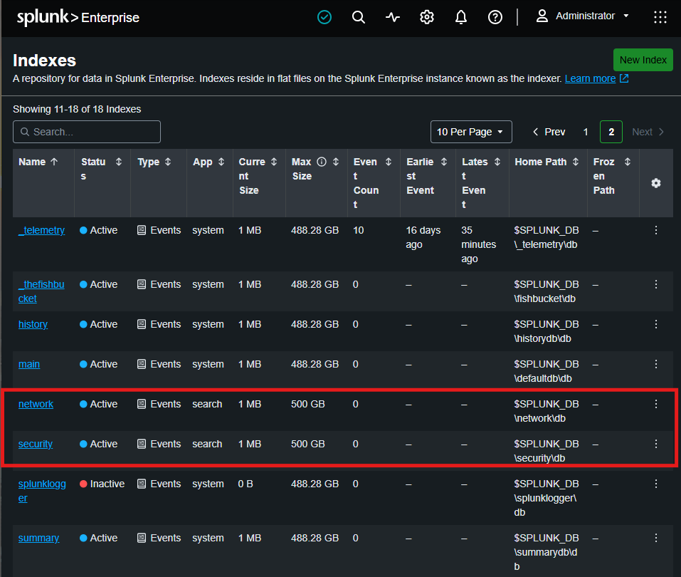 | 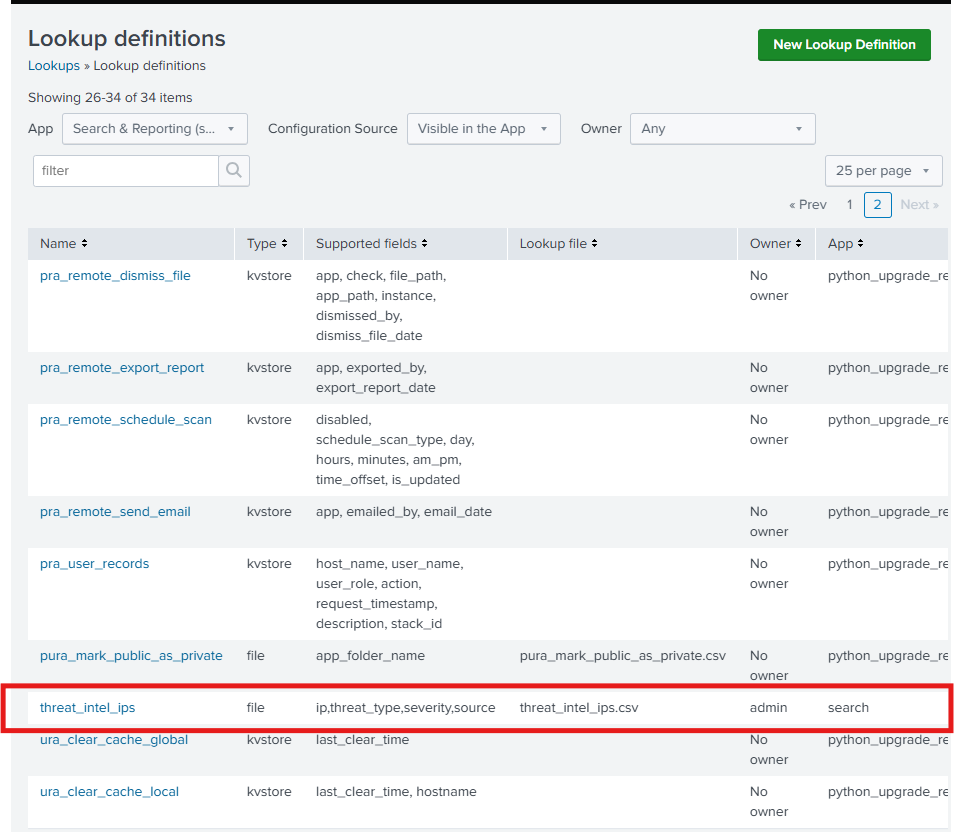 |

### Step 3: Data validation
- `security` index: **1,028 events**
- `network` index: **274 events**

### Step 4: Detection queries
Seven SPL queries, all in [`detections/`](detections).

#### Query 1: Detect Brute Force Login
Detects an attacker guessing passwords for TWP staff accounts. EventCode 4625 records each failed login; 5 or more failures from the same IP in a short period suggests brute force.

**MITRE ATT&CK:** T1110.001 Password Guessing, T1110.003 Password Spraying

Results: brute force attempts against
- **oliver.harrington** from 92.40.184.220 (UK suspicious VPN)
- **james.fitzgerald** from 203.0.113.77 (APT)
- **william.ashworth** (CFO) from 198.51.100.12
- **marcus.delgado** (NY VP) from 194.165.16.11
- **priya.bhattacharya** (Toronto PM) from 45.129.56.200
- **charlotte.whitfield** from 92.40.184.220
- **svc_swift** from 203.0.113.77
- **administrator** from 10.0.0.23

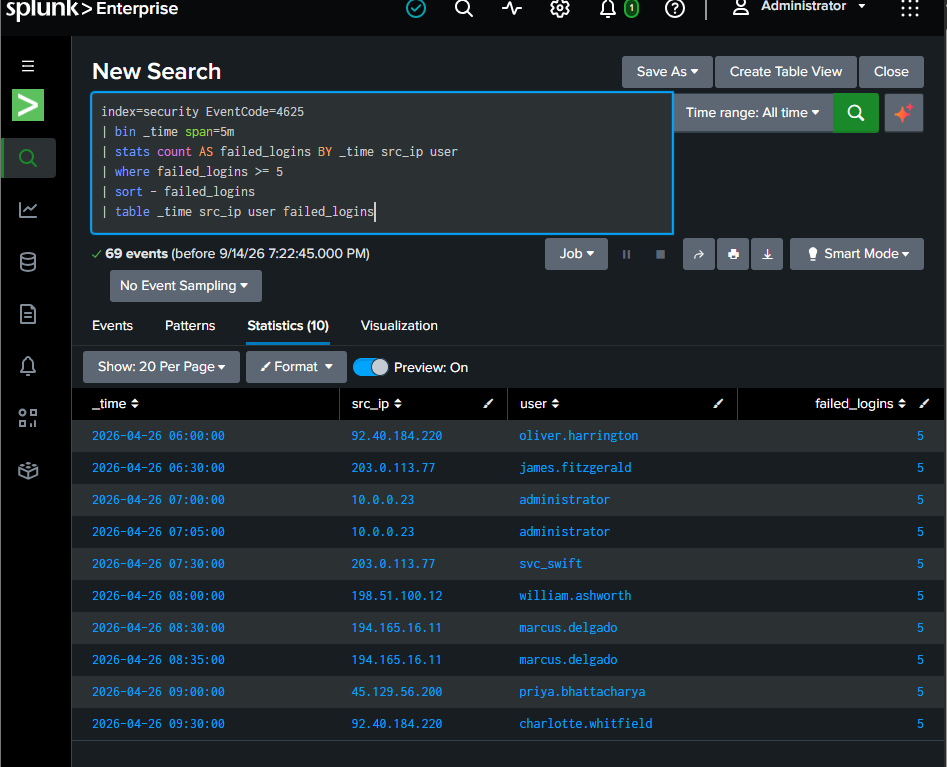

#### Query 2: Detect Account Compromise
The most hazardous outcome of brute force: failures from the same source IP and user, followed by a success.

**MITRE ATT&CK:** T1078 Valid Accounts, T1078.002 Domain Accounts

| User | Source IP | Failures | Successes | Risk score |
|---|---|---|---|---|
| oliver.harrington | 92.40.184.220 | 8 | 1 | 80 |
| james.fitzgerald (IT Security Lead) | 203.0.113.77 | 6 | 1 | 60 |

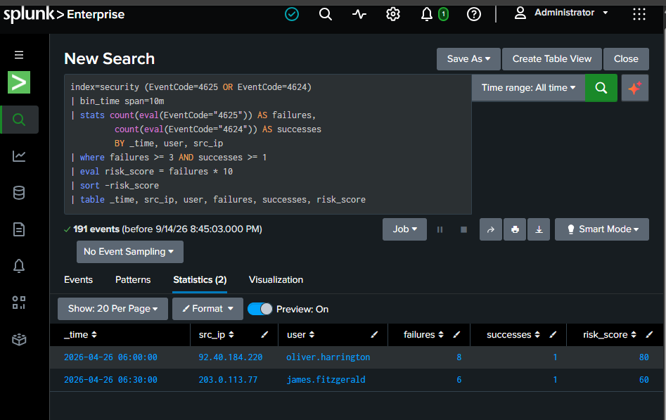

#### Query 3: Detect Privilege Escalation
Accounts added to powerful security groups, monitored through EventCodes 4728 (Global), 4732 (Local) and 4756 (Universal).

**MITRE ATT&CK:** T1098 Account Manipulation, T1098.007 Additional Local or Domain Groups

- **svc_swift** (SWIFT wire service) added to **Enterprise Admins** by james.fitzgerald
- **anthony.romano** (Helpdesk Tech, NYC) added to **Domain Admins** by james.fitzgerald
- **oliver.harrington** added himself to local **Administrators** on TWP-LON-SWIFT01
- **connor.macdonald** (Junior Analyst, Toronto) added to **Schema Admins** by the administrator

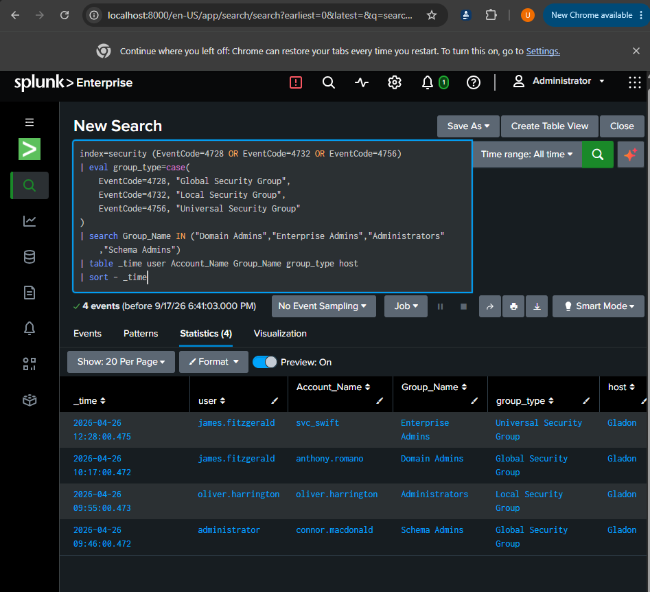

#### Query 4: Detect Data Exfiltration
Flags any internal host sending more than 50 MB to a single external destination within 10 minutes, which may indicate theft of client portfolios, trading algorithms or SWIFT credentials.

**MITRE ATT&CK:** T1041 Exfiltration Over C2 Channel, T1048 Exfiltration Over Alternative Protocol

| Source | Destination | Port | MB | Note |
|---|---|---|---|---|
| 192.168.10.10 (Oliver's London PC) | 194.165.16.11 | 8443 | 135 | APT C2 |
| 192.168.10.20 (London) | 45.129.56.200 | 22 | 93 | SSH, most likely SWIFT data |
| 192.168.10.15 (James's PC) | 194.165.16.11 | 443 | 81 | HTTPS to APT |
| 10.10.0.15 (NYC analyst) | 185.220.101.55 | 4444 | 69 | TOR |
| 10.20.0.10 (Toronto PM) | 91.108.4.183 | 443 | 55 | HTTPS |

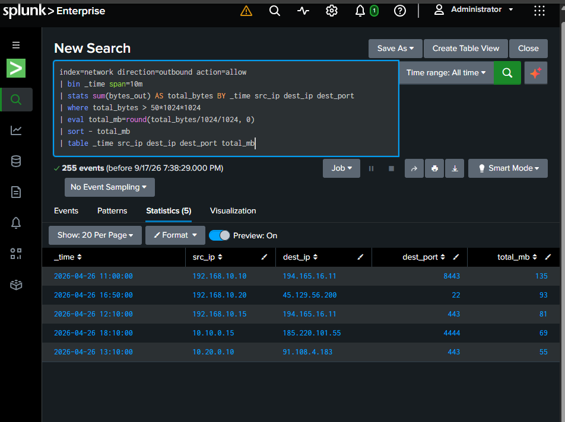

#### Query 5: Detect New User Account Created
After breaching a network, attackers create new accounts as a backdoor (EventCode 4720). An unauthorised account is also an FCA reporting issue for a regulated firm.

**MITRE ATT&CK:** T1136.002 Create Account: Domain Account, T1136.001 Local Account

- **backdoor_admin**: created by SYSTEM, clearly malicious name
- **temp_auditor**: created by james.fitzgerald (compromised account)
- **svc_test**: created by anthony.romano (newly created Domain Admin)

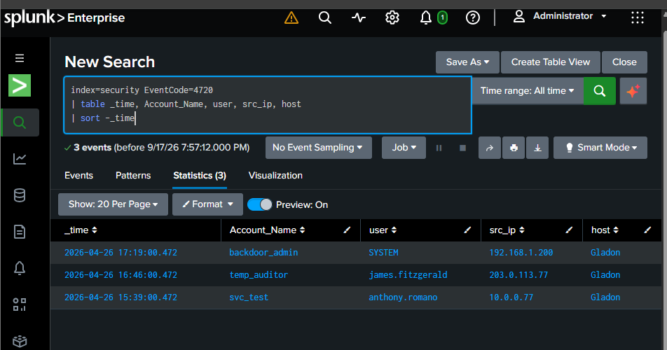

#### Query 6: Detect Ransomware Behaviour
Ransomware encrypts files at machine speed. EventCode 4663 records file access; one user changing 200+ files in one minute is malware, not a human.

**MITRE ATT&CK:** T1486 Data Encrypted for Impact

| Account | File ops / min | Note |
|---|---|---|
| svc_backup | 340 | TWP-LON-FILE01, the most affected London file server |
| emma.pemberton | 265 | Head of Risk workstation, TWP-LON-WS-EPEMBERTON |
| svc_backup | 225 | Toronto file server TWP-TOR-FILE01, indicating lateral movement |

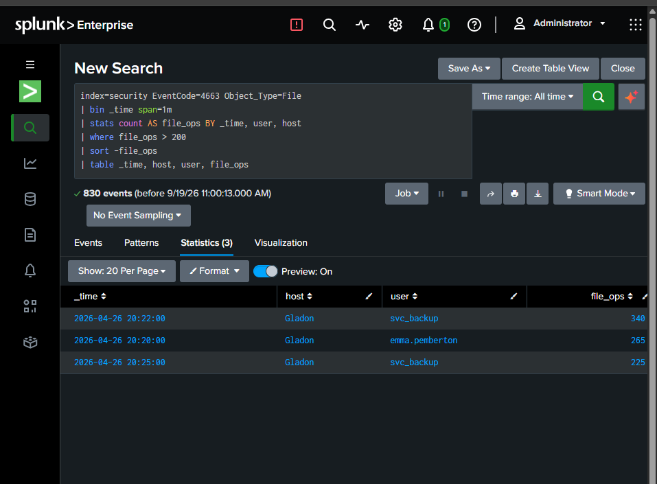

#### Query 7: Detect Threat Intelligence Match
Compares TWP network traffic with known malicious IPs (TOR exit nodes, APT C2 servers, banking trojan infrastructure).

**MITRE ATT&CK:** T1071.001 Web Protocols, T1090.003 Multi-hop Proxy, T1571 Non-Standard Port

| Malicious IP | Threat | Severity | Feed | Internal hosts |
|---|---|---|---|---|
| 194.165.16.11 | APT C2 Server | Critical | EmergingThreats | 192.168.10.10, 192.168.10.15 (London HQ) |
| 45.129.56.200 | Financial Malware C2 | Critical | MalwareBazaar | 192.168.10.20 (London HQ) |
| 185.220.101.55 | TOR Exit Node | High | AbuseIPDB | 10.10.0.15 (New York) |
| 91.108.4.183 | Banking Trojan | High | Feodo Tracker | 10.20.0.10 (Toronto) |

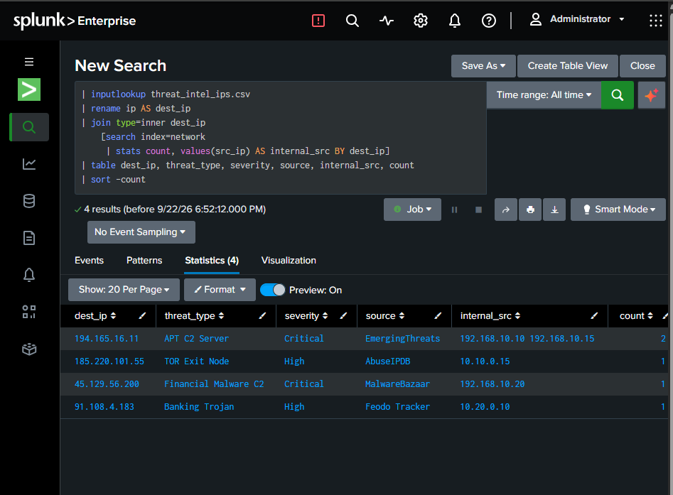

### Step 5: Turning queries into alerts
Each query was saved as a scheduled alert so Splunk runs it automatically and alerts the SOC team. Settings for every alert are in [`alerts/`](alerts).

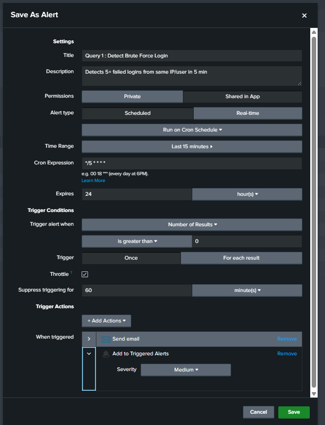

### Step 6: SOC dashboard
All detections brought together on the **TWP Global SOC Dashboard**: KPI panels, security event timeline, outbound traffic trend, top attackers, geographic office breakdown and a table for every query. Details in [`dashboards/`](dashboards).

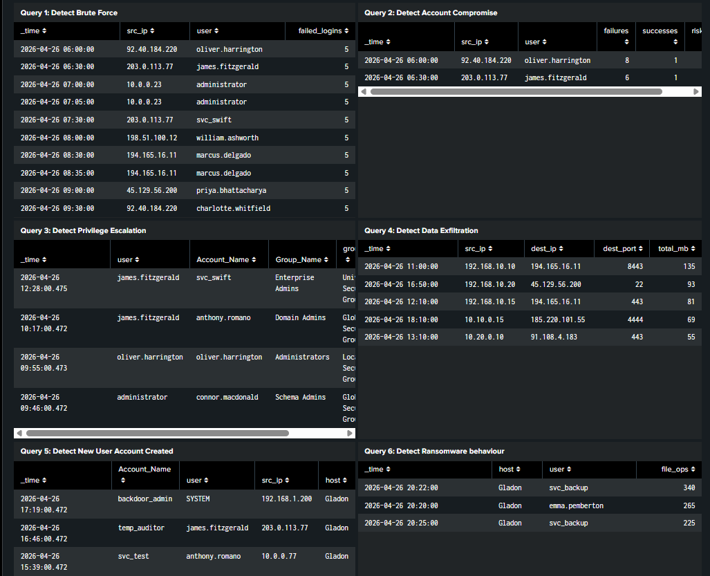

## Attack timeline (26 April 2026)

Putting the results of all seven queries in time order shows one attack chain, from password guessing in the morning to ransomware in the evening.

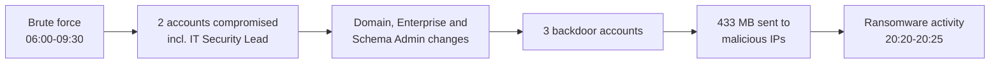

| Time | Stage | What happened | Detected by |
|---|---|---|---|
| 06:00 | Credential access | oliver.harrington brute-forced from 92.40.184.220. 8 failures then a successful logon. | Query 1, Query 2 |
| 06:30 | Credential access | james.fitzgerald (IT Security Lead) brute-forced from 203.0.113.77. 6 failures then success. | Query 1, Query 2 |
| 07:00-07:05 | Credential access | Built-in administrator account hit from 10.0.0.23 (internal, not an office subnet). | Query 1 |
| 07:30-09:30 | Credential access | Failed attempts on svc_swift, william.ashworth (CFO), marcus.delgado, priya.bhattacharya and charlotte.whitfield. | Query 1 |
| 09:46 | Privilege escalation | administrator adds connor.macdonald (Junior Analyst) to Schema Admins. | Query 3 |
| 09:55 | Privilege escalation | oliver.harrington adds his own account to local Administrators. | Query 3 |
| 10:17 | Privilege escalation | james.fitzgerald adds anthony.romano (Helpdesk) to Domain Admins. | Query 3 |
| 11:00 | Exfiltration | 192.168.10.10 (Oliver's PC) sends 135 MB to 194.165.16.11:8443 (APT C2). | Query 4, Query 7 |
| 12:10 | Exfiltration | 192.168.10.15 (James's PC) sends 81 MB to 194.165.16.11:443 (APT C2). | Query 4, Query 7 |
| 12:28 | Privilege escalation | james.fitzgerald adds svc_swift to Enterprise Admins. | Query 3 |
| 13:10 | Exfiltration | 10.20.0.10 (Toronto) sends 55 MB to 91.108.4.183:443 (banking trojan). | Query 4, Query 7 |
| 15:39 | Persistence | anthony.romano (now a Domain Admin) creates svc_test from 10.0.0.77. | Query 5 |
| 16:46 | Persistence | james.fitzgerald creates temp_auditor from 203.0.113.77, the same external IP that brute-forced him. | Query 5 |
| 16:50 | Exfiltration | 192.168.10.20 (London) sends 93 MB over SSH to 45.129.56.200:22 (financial malware C2). | Query 4, Query 7 |
| 17:19 | Persistence | SYSTEM creates backdoor_admin from 192.168.1.200 (not an office subnet). | Query 5 |
| 18:10 | Exfiltration | 10.10.0.15 (New York) sends 69 MB to 185.220.101.55:4444 (TOR exit node). | Query 4, Query 7 |
| 20:20 | Impact | Ransomware-rate file activity by emma.pemberton: 265 file operations in one minute. | Query 6 |
| 20:22 | Impact | svc_backup: 340 file operations in one minute (London file server in the scenario). | Query 6 |
| 20:25 | Impact | svc_backup: 225 file operations in one minute (Toronto file server in the scenario). | Query 6 |

Key observations:
- **temp_auditor** was created from **203.0.113.77**, the same external IP that brute-forced james.fitzgerald at 06:30. The compromised account was still being used from outside the network ten hours later.
- **194.165.16.11** and **45.129.56.200** appear twice: as brute-force sources and as destinations for exfiltrated data.
- **10.0.0.23**, **10.0.0.77** and **192.168.1.200** do not belong to any of the three office subnets.

## Repository structure

```
.
├── README.md
├── detections/     the seven SPL queries
├── alerts/         alert schedule, severity and throttle settings
├── dashboards/     dashboard panels
├── mitre/          ATT&CK mapping and Navigator layer
├── data/           description of the datasets
└── screenshots/    evidence from every step
```

## Skills

Splunk Enterprise · SPL · SIEM deployment · Detection engineering · Alerting · Dashboards · Threat intelligence · MITRE ATT&CK · Windows Security event logs · RBAC

## Author

Gladon, SOC Analyst · MSc Cyber Security · [LinkedIn](https://www.linkedin.com/in/YOUR-PROFILE)
